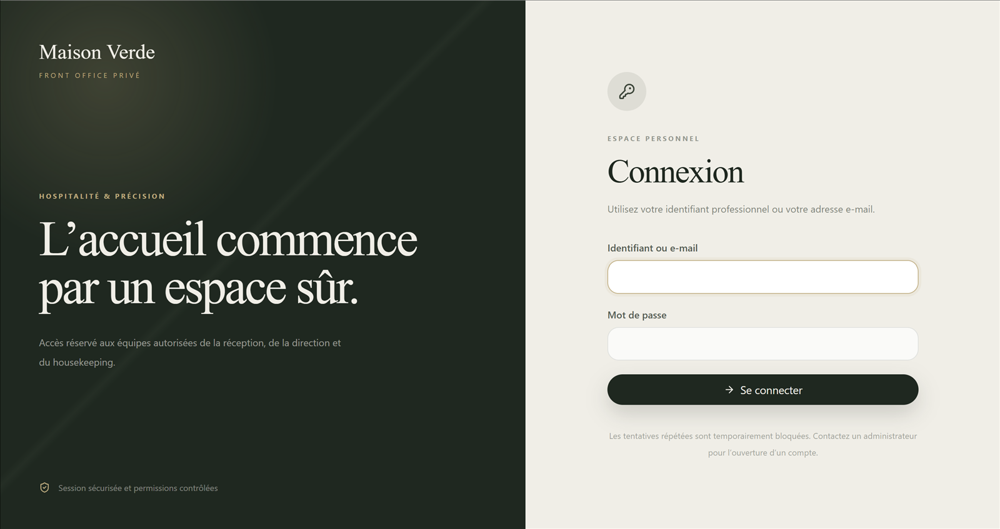
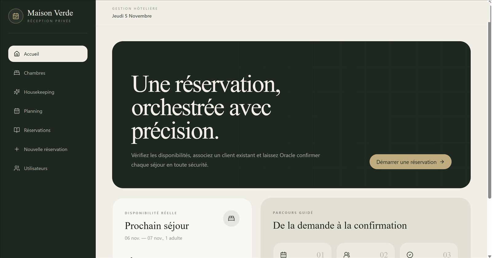
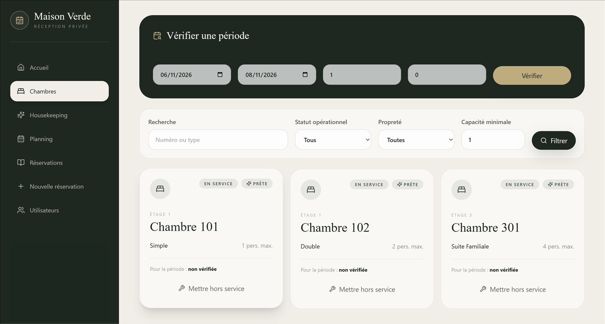
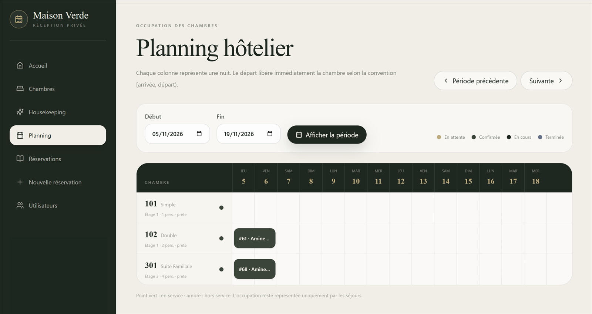
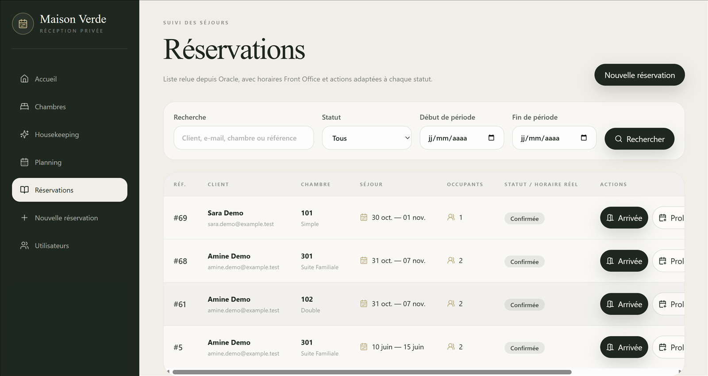
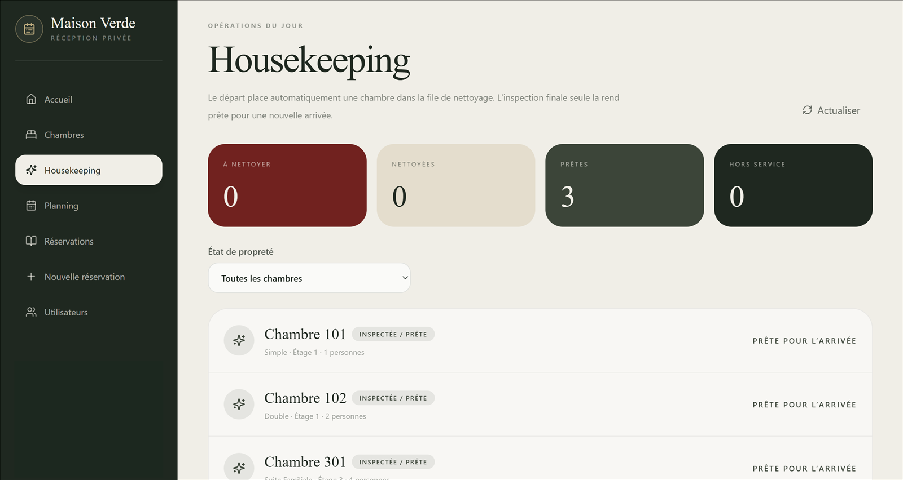
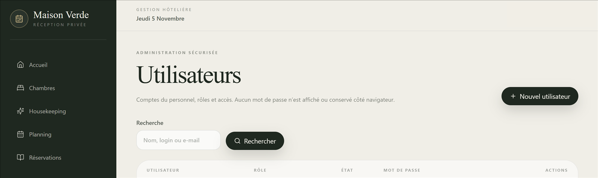

# Maison Verde

Maison Verde is a full-stack hotel front-office platform built as a modular monolith. It connects a premium React reception dashboard to a Spring Boot REST API and an Oracle database that enforces reservation integrity, capacity rules, room operations, and concurrent booking safety.

The project evolves an academic Oracle SQL/PL/SQL hotel system into a portfolio-ready application while preserving the original relational, object-relational, and multimedia scripts as separate academic references.

## Product overview

- Search room availability by stay dates and occupancy.
- Manage clients and complete reservation workflows.
- Modify, cancel, extend, check in, and check out stays.
- Visualize occupancy through a hotel planning board.
- Track room housekeeping and operational status independently.
- Authenticate staff with server-side sessions and role-based access control.
- Administer staff accounts without exposing passwords to the browser.

## Gallery

<table>
  <tr>
    <td width="50%"></td>
    <td width="50%"></td>
  </tr>
  <tr>
    <td align="center"><sub><b>Secure staff login</b></sub></td>
    <td align="center"><sub><b>Reception dashboard</b></sub></td>
  </tr>
  <tr>
    <td></td>
    <td></td>
  </tr>
  <tr>
    <td align="center"><sub><b>Room catalogue and live availability</b></sub></td>
    <td align="center"><sub><b>Hotel occupancy planning</b></sub></td>
  </tr>
  <tr>
    <td></td>
    <td></td>
  </tr>
  <tr>
    <td align="center"><sub><b>Reservation lifecycle management</b></sub></td>
    <td align="center"><sub><b>Housekeeping operations</b></sub></td>
  </tr>
</table>

<p align="center">
  
  <br />
  <sub><b>Role-based staff administration</b></sub>
</p>

All screenshots use fictitious demonstration data. Credentials, personal information, and local configuration values are excluded.

## Architecture

```text
React + TypeScript + Vite
          |
          | REST / JSON + session cookie + CSRF
          v
Spring Boot modular monolith
Controller -> Service -> Repository / DTO
          |
          | JPA and Spring JDBC
          v
Oracle Free 23 / SQL / PL/SQL
```

The backend is organized by business capability rather than by a single global technical layer:

- `availability` — date and occupancy-based room search.
- `client` — client search and creation.
- `reservation` — creation, consultation, update, cancellation, and concurrency control.
- `frontoffice` — check-in, check-out, and stay extension.
- `planning` — optimized occupancy timeline queries.
- `room` — catalogue, housekeeping, and operational status.
- `security` and `user` — authentication, authorization, and staff administration.
- `shared` — cross-cutting configuration and error handling.

Spring owns application transactions through `@Transactional`. PL/SQL routines called by Java do not perform internal `COMMIT` or `ROLLBACK` operations.

## Technology stack

| Area | Technologies |
|---|---|
| Frontend | React 19, TypeScript, Vite 6, Tailwind CSS 4, React Router |
| Backend | Java 17, Spring Boot 3.5, Spring Web, Validation, Security, Data JPA, JDBC |
| Database | Oracle Free 23, SQL, PL/SQL, sequences, triggers, packages, constraints |
| Testing | JUnit 5, Spring MockMvc, Oracle integration tests, TypeScript compiler |
| Tooling | Maven Wrapper, npm, Docker Compose, Git |

## Reservation and room rules

- Stays follow the half-open interval convention `[check-in, check-out)`.
- Check-out must be strictly later than check-in.
- Occupancy cannot exceed the room type capacity.
- Rooms under maintenance cannot be booked.
- Cancelled reservations no longer block availability.
- Room locks and Oracle overlap checks protect concurrent creation and modification.
- Check-in and check-out transitions are atomic and retain actual arrival/departure timestamps.
- Check-out changes the cleaning state without confusing it with operational availability.

## Authentication and roles

Authentication uses a server-side `JSESSIONID` session, BCrypt password hashes, CSRF protection, a strict local CORS origin, temporary account lockout, and mandatory initial password changes. No account or password is committed to the repository.

| Role | Main permissions |
|---|---|
| `ADMIN` | Full access, staff administration, reservations, rooms, planning, housekeeping |
| `MANAGER` | Reservations, planning, room operations, maintenance, housekeeping |
| `RECEPTION` | Clients, reservations, planning, room catalogue |
| `HOUSEKEEPING` | Room catalogue and cleaning workflow without client/reservation access |

The first administrator is created only when all `APP_BOOTSTRAP_ADMIN_*` environment variables are supplied and no active administrator exists. Remove those variables after the first successful startup.

## REST API

| Method | Endpoint | Purpose |
|---|---|---|
| `GET` | `/api/v1/rooms/availability` | Search compatible available rooms |
| `GET` | `/api/v1/rooms` | List and filter rooms |
| `PATCH` | `/api/v1/rooms/{id}/housekeeping` | Update cleaning workflow |
| `PATCH` | `/api/v1/rooms/{id}/operational-status` | Update maintenance status |
| `GET`, `POST` | `/api/v1/clients` | Search or create clients |
| `GET`, `POST` | `/api/v1/reservations` | List or create reservations |
| `GET`, `PATCH` | `/api/v1/reservations/{id}` | Read or modify a reservation |
| `POST` | `/api/v1/reservations/{id}/cancel` | Cancel a reservation idempotently |
| `POST` | `/api/v1/reservations/{id}/check-in` | Register actual arrival |
| `POST` | `/api/v1/reservations/{id}/check-out` | Register actual departure |
| `PATCH` | `/api/v1/reservations/{id}/extend` | Extend an active stay |
| `GET` | `/api/v1/planning` | Load the occupancy planning period |
| `GET`, `POST`, `PATCH` | `/api/v1/users/**` | Administer staff accounts |
| `GET`, `POST` | `/api/v1/auth/**` | CSRF, login, session, password change, logout |

## Repository structure

```text
Gestion_Hotel/
├── frontend/       React reception application
├── backend/        Spring Boot modular monolith
├── database/       Oracle migrations, demo data, and verification scripts
├── docs/           Project assets and selected screenshots
├── SQL_PLSQL/      Original relational academic script
├── SGBRO/          Object-relational academic reference
├── MULTIMEDIA/     Multimedia academic reference
└── compose.yaml    Local Oracle Free service
```

## Prerequisites

- Java 17
- Node.js 20 or later
- Docker Desktop with Docker Engine and Docker Compose
- Ports `1521`, `8080`, and `5173` available locally

## Local installation

### 1. Prepare local environment variables

Copy `.env.example` to `.env.oracle.local` and replace every `replace_locally` value with a strong local-only password. The local file is ignored by Git.

```powershell
Copy-Item .env.example .env.oracle.local
```

Never commit `.env.oracle.local`, database dumps, certificates, or bootstrap credentials.

### 2. Start Oracle

```powershell
docker compose --env-file .env.oracle.local up -d
docker compose --env-file .env.oracle.local ps
```

Wait until `gestion-hotel-oracle` reports `healthy`.

### 3. Install the database in a fresh schema only

The migration runner executes V1 through V6 and then loads fictitious demo data. Run it only for a new isolated development schema.

```powershell
docker exec gestion-hotel-oracle bash -lc 'sqlplus -s "$APP_USER/$APP_USER_PASSWORD@FREEPDB1" @/opt/project/database/run_migrations.sql'
docker exec gestion-hotel-oracle bash -lc 'sqlplus -s "$APP_USER/$APP_USER_PASSWORD@FREEPDB1" @/opt/project/database/verify/verify_schema.sql'
```

The verification queries must return no invalid object and no compilation error.

### 4. Start the backend

Open a PowerShell terminal in `backend/`, load the ignored local variables, and optionally define the one-time administrator bootstrap variables.

```powershell
Get-Content ..\.env.oracle.local | ForEach-Object {
    if ($_ -match '^([A-Za-z_][A-Za-z0-9_]*)=(.*)$') {
        [Environment]::SetEnvironmentVariable($matches[1], $matches[2], 'Process')
    }
}

.\mvnw.cmd spring-boot:run
```

The API starts at `http://localhost:8080`. Hibernate validates the schema but never creates or migrates it at startup.

### 5. Start the frontend

```powershell
cd frontend
npm ci
npm run dev
```

Open `http://localhost:5173`. Use `localhost`, not `127.0.0.1`, unless `FRONTEND_ORIGIN` is changed accordingly.

## Verification

Backend tests use the isolated local Oracle schema and clean up their temporary security accounts.

```powershell
cd backend
Get-Content ..\.env.oracle.local | ForEach-Object {
    if ($_ -match '^([A-Za-z_][A-Za-z0-9_]*)=(.*)$') {
        [Environment]::SetEnvironmentVariable($matches[1], $matches[2], 'Process')
    }
}
.\mvnw.cmd clean test
```

Frontend verification:

```powershell
cd frontend
npm run typecheck
npm run build
```

The current suite contains 30 JUnit tests, including real Oracle integration coverage for reservation rollback, overlap prevention, concurrent booking, lifecycle transitions, housekeeping, authentication, CSRF, CORS, and role authorization.

## Database documentation

- Installation and migration notes: [`database/README.md`](database/README.md)
- Migration runner: [`database/run_migrations.sql`](database/run_migrations.sql)
- Schema verification: [`database/verify/verify_schema.sql`](database/verify/verify_schema.sql)
- Fictitious demo data: [`database/demo/demo_data.sql`](database/demo/demo_data.sql)

## Project status

Maison Verde currently covers the complete reservation and front-office workflow, room operations, housekeeping, planning, and staff security. Payments, invoicing, group reservations, and public deployment remain intentionally outside the current scope.
